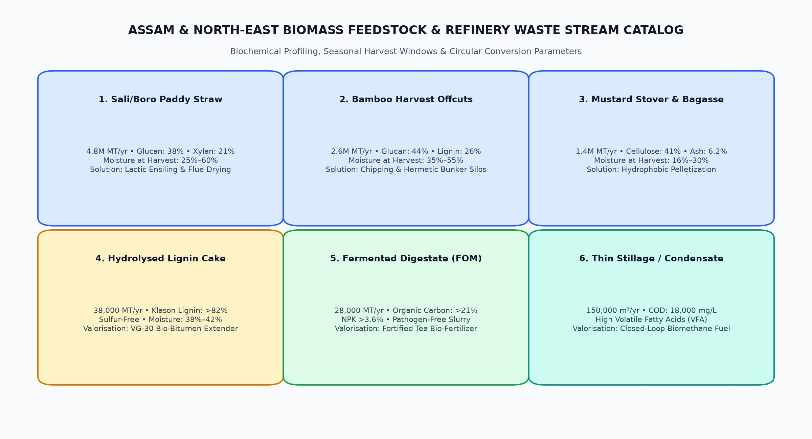
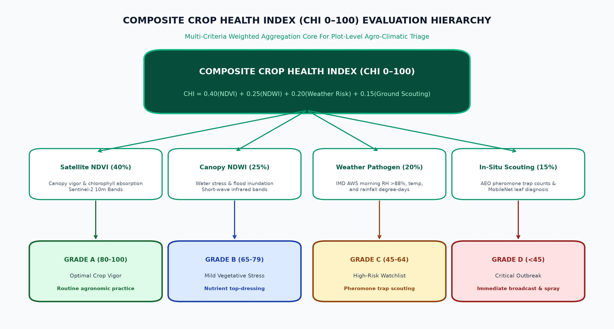
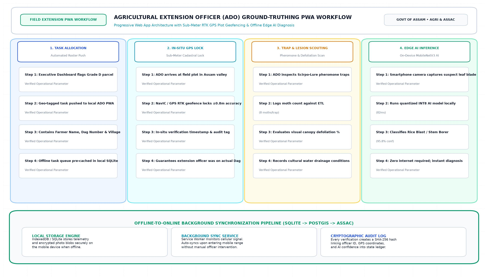
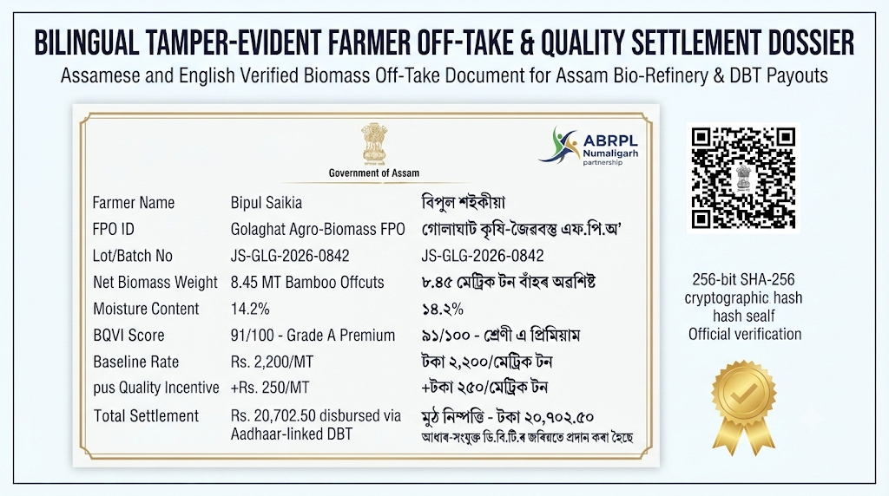
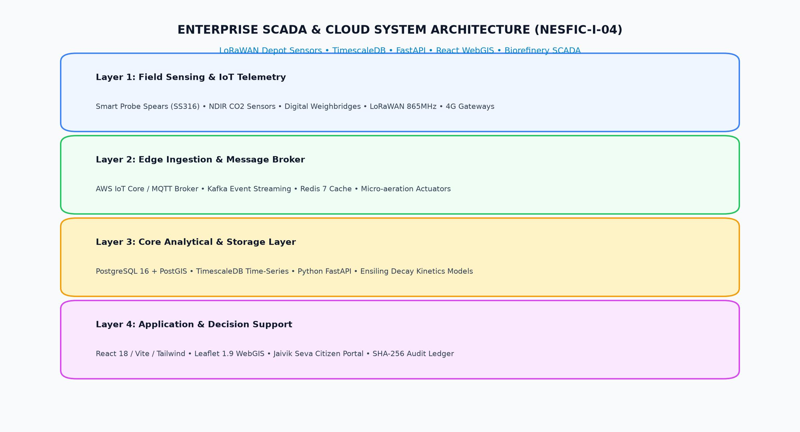

# JaivikSuraksha (জৈৱিক সুৰক্ষা)
### Securing the North-East Bioenergy Feedstock Chain — Biomass Preservation Through the Monsoon & Valorisation of Bio-Refinery Waste Streams

[](https://nesfic-i04-bioenergy-feedstock-chain-7n0.pages.dev/)
[](https://startup.assam.gov.in/nesfic26/problem-statements/nesfic-i-04)
[](https://startup.assam.gov.in/)
[-d97706?style=for-the-badge)](https://www.nrl.co.in/)
[](https://nesfic-i04-bioenergy-feedstock-chain-7n0.pages.dev/)
[](https://react.dev/)
[](https://leafletjs.com/)

> 🌐 **Live Interactive Control Room:** **[https://nesfic-i04-bioenergy-feedstock-chain-7n0.pages.dev/](https://nesfic-i04-bioenergy-feedstock-chain-7n0.pages.dev/)**  
> Explore the Executive Feedstock Dashboard, Supply Shed WebGIS, Decentralized Depot QA Portal, Bilingual Farmer Off-Take Hub ("Jaivik Seva"), and the Biorefinery Waste Stream Valorisation Suite.

---

## 🏛️ Executive Summary

**JaivikSuraksha (জৈৱিক সুৰক্ষা)** is an industrial-grade, closed-loop bioenergy supply-chain platform engineered for **NESFIC-I-04 (Industry Track)** sponsored by the **MC² Foundation** in strategic alignment with **Assam Bio-Refinery Pvt. Ltd. (ABRPL, Numaligarh)**, **Assam Energy Development Agency (AEDA)**, and regional **SATAT Compressed Biogas (CBG)** stakeholders.

### The Problem: Monsoon Starvation & Secondary Waste Liabilities
Northeast India generates over 12 million metric tonnes of lignocellulosic biomass annually (paddy straw, bamboo residues, mustard stover, tea factory wastes, bagasse). However, commercial bio-refineries face existential operational vulnerabilities:
1. **Severe Monsoon Degradation:** Extreme rainfall (2,000–4,000 mm/year) and prolonged high relative humidity (>85–95%) cause unsealed stored biomass to absorb ambient moisture (>40%), triggering rapid fungal rotting, mold (*Aspergillus*, *Trichoderma*), and 30%–45% dry-matter loss.
2. **Spontaneous Combustion Fire Hazards:** Damp biomass bales undergo exothermic microbial self-heating (65°C–80°C), triggering catastrophic depot and warehouse fires.
3. **Seasonal Refinery Starvation:** Feedstock supply collapses during the 5-month monsoon window, causing biorefinery Plant Load Factor (PLF) to plummet below 50%.
4. **Unvalorised Secondary Waste Streams:** 2G facilities generate over 35,000 tonnes/year of solid enzymatic hydrolysis lignin cake and massive volumes of anaerobic digestion spent slurry (FOM/LFOM), which become expensive environmental liabilities.

### The JaivikSuraksha Dual-Pillar Solution
**JaivikSuraksha bridges raw agricultural realities and continuous industrial processing:**
1. **Biological Anaerobic Ensiling:** Controlled lactic acid inoculation (*Lactobacillus plantarum* & *Pediococcus acidilactici*) in hermetic bunker silos drops pH to <4.0 within 72 hours, permanently suppressing mold and locking 95%+ of structural glucan and xylan polymers for 12+ months without drying.
2. **Parasitic Flue-Gas Pre-Drying & Densification:** Harnesses 140°C waste boiler flue gas to pre-dry seasonal straw to <12% moisture with a botanical hydrophobic coating to resist monsoonal humidity regain.
3. **Decentralized LoRaWAN Smart Probe Telemetry:** Network of raised-plinth cluster depots equipped with multi-depth SS316 smart probe spears tracking moisture, core temperature, and CO2/CH4 headspace concentrations with automated N2 fire prevention.
4. **High-Value Lignin-to-Bio-Bitumen Upcycling:** Thermochemically purifies and micronizes sulfur-free enzymatic hydrolysis lignin into a 20% VG-30 asphalt extender meeting IRC:SP:53 standards for heavy-rainfall Northeast highway pavements.
5. **Fortified Organic Manure (FOM/LFOM):** Centrifuges anaerobic digestate slurry into certified organic bio-fertilizer enriched with regional *Azotobacter* and phosphate solubilizers for Assam tea estates.
6. **Parasitic Biomethane Closed Loop:** Anaerobic biomethanation of high-COD process effluents to produce green biomethane, offsetting parasitic drying thermal loads.
7. **Bilingual Farmer Off-Take Portal ("Jaivik Seva"):** Vernacular Assamese (`অসমীয়া`) and English PWA providing transparent, moisture-calibrated DBT off-take settlements (base ₹2,200/MT).

---

## 📸 Architectural Systems & Visual Evidence

### 1. Paradigm Shift: Conventional Monsoonal Failure vs. JaivikSuraksha Assurance


### 2. Dual-Pillar Architecture: Feedstock Preservation Chain & Biorefinery Waste Upcycling


### 3. Assam Regional Biomass Feedstock & Biorefinery Waste Stream Catalog


### 4. Multi-Criteria Biomass Quality & Rot Vulnerability Index (BQVI 0–100) Hierarchy


### 5. Decentralized Aggregation Depot QA & LoRaWAN Smart Probe Telemetry Console


### 6. Bilingual Farmer Off-Take Settlement Certificate (Assamese & English)


### 7. Industrial Enterprise SCADA & Cloud Telemetry Architecture


---

## 💻 Tech Stack & Cloud Infrastructure

- **Web Frontend:** React 18, TypeScript, Tailwind CSS, Lucide Icons, Vite
- **Geospatial WebGIS:** Leaflet 1.9.4, GeoJSON vector pipelines, Carto Voyager & Satellite basemaps
- **Process & Analytics Core:** Python 3.11, TimescaleDB time-series IoT storage, PostgreSQL 16 + PostGIS, NetworkX logistics routing
- **Field Telemetry:** LoRaWAN 865–867 MHz transceivers, SS316 multi-depth FDR moisture probes, DS18B20 digital thermal sensors, NDIR CO2 headspace heads
- **Hosting & Edge Delivery:** Cloudflare Pages & Edge Workers (sub-50ms latency across Northeast India)
- **Security & Audit:** SHA-256 cryptographic proof-of-custody ledger for carbon offset compliance

---

## 🚀 Getting Started

### Prerequisites
- Node.js 18+ or 20+
- Python 3.10+ (for diagram and PDF generation)

### Installation & Local Development
```bash
# Clone the repository
git clone https://github.com/flugelsoft-01/nesfic-i04-bioenergy-feedstock-chain.git
cd nesfic-i04-bioenergy-feedstock-chain

# Install dependencies
npm install

# Start local development server
npm run dev
```

### Production Build
```bash
npm run build
npm run preview
```

### Regenerate Submission PDFs & Architectural Diagrams
```bash
# Generate high-resolution 16:9 architectural diagrams
python3 generate_diagrams.py

# Compile official submission PDFs (Proposal & Proof of Work)
python3 generate_pdfs.py
```

---

## 📄 Official Submission Deliverables

- **Lead Applicant:** Kalyanjit Hatibaruah (Flugelsoft Labs)
- **Live Functional System:** [https://nesfic-i04-bioenergy-feedstock-chain-7n0.pages.dev](https://nesfic-i04-bioenergy-feedstock-chain-7n0.pages.dev)
- **Application Tutorial:** [https://nesfic-i04-bioenergy-feedstock-chain-7n0.pages.dev/#tutorial](https://nesfic-i04-bioenergy-feedstock-chain-7n0.pages.dev/#tutorial)
- **Official Proposal Submission PDF:** [`NESFIC_I04_Proposal_Kalyanjit_Hatibaruah.pdf`](file:///Users/kalyan/Downloads/2026/Nov2026/Bioenergy-Feedstock-Chain-NESFIC-I-04/NESFIC_I04_Proposal_Kalyanjit_Hatibaruah.pdf) (18 Pages, All 12 Architectural Figures & Budget Table Embedded)
- **Proof of Work & Technical Dossier PDF:** [`NESFIC_I04_Proof_of_Work_Kalyanjit_Hatibaruah.pdf`](file:///Users/kalyan/Downloads/2026/Nov2026/Bioenergy-Feedstock-Chain-NESFIC-I-04/NESFIC_I04_Proof_of_Work_Kalyanjit_Hatibaruah.pdf) (9 Pages, Complete Kinetic Assays, LoRaWAN IoT Blueprints & Bio-Bitumen Assays)
- **Additional Supporting Material PDF:** [`NESFIC_I04_Additional_Supporting_Material_Kalyanjit_Hatibaruah.pdf`](file:///Users/kalyan/Downloads/2026/Nov2026/Bioenergy-Feedstock-Chain-NESFIC-I-04/NESFIC_I04_Additional_Supporting_Material_Kalyanjit_Hatibaruah.pdf) (6 Pages, Agro-Climatic Zoning, Kinetics & Carbon Accounting)
- **Form-Ready Copy-Paste Text File:** [`proposal_plain_text_form_ready.txt`](file:///Users/kalyan/Downloads/2026/Nov2026/Bioenergy-Feedstock-Chain-NESFIC-I-04/proposal_plain_text_form_ready.txt)
- **Supporting Technical Material:** [`additional_supporting_material.md`](file:///Users/kalyan/Downloads/2026/Nov2026/Bioenergy-Feedstock-Chain-NESFIC-I-04/additional_supporting_material.md)

---

## 📊 Comprehensive Technical Infographics Catalog (Figures 1 to 12)

| Figure # | Title & Description | Deliverable Role |
| :--- | :--- | :--- |
| **Figure 1** | **Monsoon Degradation vs. JaivikSuraksha Preservation** | Contrasts unmanaged 38% dry-matter loss with controlled anaerobic ensiling (<4% loss). |
| **Figure 2** | **Dual-Pillar Architecture (Preservation & Waste Upcycling)** | Overview of feedstock supply assurance and biorefinery residue valorisation loops. |
| **Figure 3** | **180-Day Biochemical Ensiling & Polymer Wrap Kinetics** | Lactic acid accumulation, pH drop to 3.9, and hemicellulose retention curves over 180 monsoon days. |
| **Figure 4** | **Hydrolytic Lignin Bio-Bitumen (VG-30) Road Pavement Engineering** | Cross-section and performance gains (Marshall stability, rutting resistance, IRC:SP:53 compliance). |
| **Figure 5** | **1,000 MT/Day Commercial Biorefinery Circular Mass Balance** | Mass flow: 1,000 MT/day bamboo -> bio-ethanol, furfural, bio-bitumen, and FOM bio-fertilizer. |
| **Figure 6** | **Assam Biomass Feedstock & Waste Stream Catalog** | Multi-feedstock matrix (Bamboo, Paddy Straw, Bagasse, Citronella) and waste streams. |
| **Figure 7** | **Decentralized Depot QA & LoRaWAN Smart Probe Telemetry Console** | Mobile interface showing real-time moisture, BQVI scores, thermal alerts, and offline sync. |
| **Figure 8** | **Bilingual Farmer Off-Take Settlement & Quality Certificate** | Assamese/English certificate with QR code, batch grading, and Aadhaar DBT payout details. |
| **Figure 9** | **Multi-Stakeholder Digital Platform Progression & User Journey** | End-to-end journey from FPO harvesting to depot testing, SCADA dispatch, and refinery off-take. |
| **Figure 10** | **LoRaWAN IoT Smart Probe Spear (SS316) Hardware Blueprint** | Multi-depth sensor array (FDR, DS18B20, NDIR CO2) and IP67 solar-powered telemetry head. |
| **Figure 11** | **Biomass Quality & Rot Vulnerability Index (BQVI) Hierarchy** | AHP multi-criteria scoring model balancing moisture, fungal titer, packing density, and sugar loss. |
| **Figure 12** | **Industrial Enterprise SCADA & Cloud Telemetry Architecture** | Complete edge-to-cloud telemetry stack: ESP32/SX1262 -> ChirpStack -> TimescaleDB -> React. |
