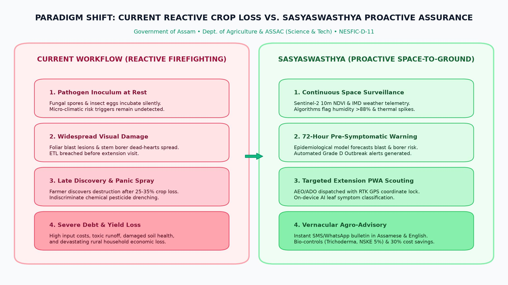
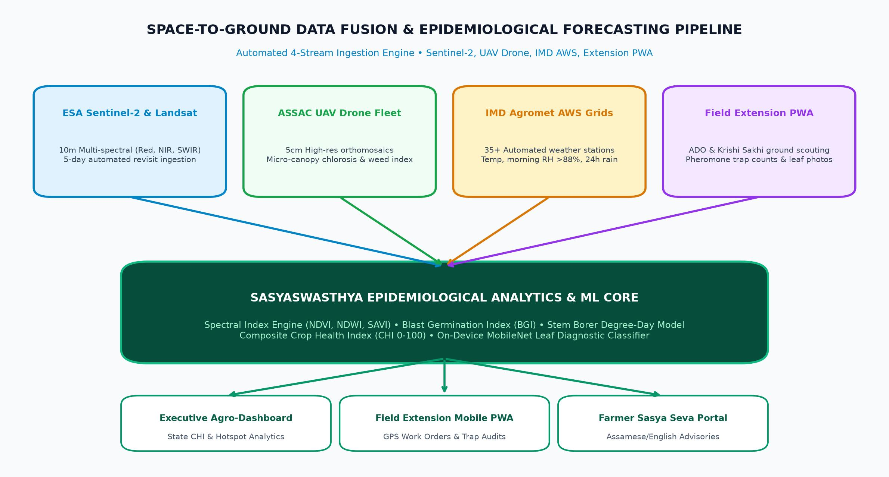

# SasyaSwasthya (শস্য স্বাস্থ্য)
### Assam Crop Health Monitoring, Pest & Disease Forecasting and Location-Specific Advisory System

[](https://sasya-swasthya.pages.dev/)
[](https://diragri.assam.gov.in/)
[](https://startup.assam.gov.in/nesfic26/problem-statements/nesfic-d-11)
[](https://sasya-swasthya.pages.dev/)
[](https://react.dev/)
[](https://leafletjs.com/)

> 🌐 **Live Interactive Prototype:** **[https://sasya-swasthya.pages.dev/](https://sasya-swasthya.pages.dev/)**  
> Explore the Executive Agro-Dashboard, Multi-Spectral Satellite & Drone WebGIS, Agricultural Extension PWA, Farmer Advisory Portal ("Sasya Seva"), and the **Super Admin Command Console (`#admin-console`)**.

---

## 🏛️ Executive Summary

**SasyaSwasthya (শস্য স্বাস্থ্য)** is an intelligent space-to-ground agricultural intelligence, epidemiological pest forecasting, and hyper-local agro-advisory platform developed for the **Department of Agriculture** and the **Assam State Space Application Centre (ASSAC)**, Department of Science & Technology, Government of Assam under **NESFIC-D-11 (Government Track)** in partnership with **Assam Agricultural University (AAU), Jorhat**.

Traditional agricultural disease management is **reactive**: infestations of Rice Blast (*Magnaporthe oryzae*), Yellow Stem Borer (*Scirpophaga incertulas*), Sheath Blight (*Rhizoctonia solani*), and Mustard Aphids (*Lipaphis erysimi*) are noticed only after severe foliar damage or dead-hearts appear across whole village clusters—resulting in 25–35% yield losses, panic chemical spraying, and farmer debt.

**SasyaSwasthya inverts this paradigm** into continuous, space-to-ground precision assurance:
1. **Continuous Multi-Spectral Satellite Surveillance:** Ingests ESA Sentinel-2 10m surface reflectance and Landsat 8/9 imagery every 5 days, calculating NDVI (canopy vigor), NDWI (water deficit/flood ponding), and SAVI with automated cloud masking.
2. **High-Resolution Drone Telemetry:** Fuses ASSAC UAV drone flights at 5cm/pixel resolution over priority agricultural blocks.
3. **Epidemiological Forecast Engine:** Coupes real-time telemetry from 35+ IMD Automated Weather Stations (AWS) with degree-day and humidity models to forecast Rice Blast and Stem Borer outbreaks **72 to 120 hours in advance**.
4. **Composite Crop Health Index (CHI 0–100):** Triages every farm plot into 4 actionable risk grades (Grade A Optimal to Grade D Critical Outbreak).
5. **Field Ground-Truthing PWA:** Equips Agricultural Development Officers (ADO) and Krishi Sakhis with an offline-first mobile app featuring sub-meter RTK GPS plot coordinate geofencing, pheromone trap logging, and an on-device MobileNet AI leaf disease diagnostic camera.
6. **Farmer "Sasya Seva" Portal & Dispatcher:** Delivers targeted, hyper-local advisories in **Assamese (অসমীয়া)** and English with specific bio-control formulations (Trichoderma, NSKE 5%, Scirpo-lure) via SMS and WhatsApp Cloud API.
7. **Agro-Command & Admin Console:** Real-time role-based control room for ASSAC analysts, DAOs, and AAU scientists to calibrate thresholds and dispatch geo-fenced emergency bulletins.

---

## 📸 Technological Architecture & Visual Evidence

### 1. Paradigm Shift: Reactive Crop Loss vs. Proactive Space-to-Ground Early Warning


### 2. Multi-Tier Space-to-Ground Data Fusion Pipeline (Sentinel-2, Drone, Weather, Field)


### 3. Assam Crop Pathogen & Biotic Stress Surveillance Catalog


### 4. Composite Crop Health Index (CHI 0–100) Multi-Criteria Evaluation Hierarchy


### 5. Agricultural Extension Officer (ADO) Ground-Truthing & Edge AI PWA


### 6. Official Bilingual Agro-Advisory Bulletin (Assamese & English)


### 7. Assam State Data Centre (ASDC) Production Enterprise Cloud Architecture


---

## 💻 Tech Stack & Infrastructure

- **Web Frontend:** React 18, TypeScript, Tailwind CSS, Lucide Icons, Vite
- **WebGIS Engine:** Leaflet 1.9.4, GeoJSON vector renderers, Carto Voyager & Satellite basemaps
- **Remote Sensing Core:** Python 3.13, PostGIS 3.4, RasterFrames, Sentinel-2 Level-2A BOA bands, Assam BKL Engine ($1\text{ Bigha} = 5\text{ Katha} = 100\text{ Lesa} \approx 1337.8\text{ m}^2$)
- **Edge AI & Computer Vision:** Quantized MobileNet-V3 running on-device for real-time leaf lesion classification
- **Cloud & Edge Hosting:** Cloudflare Pages (SPA redirects, edge headers, asset optimization)
- **State Data Centre Target:** Kubernetes, Kafka event queues, Redis, PostgreSQL 16 + PostGIS, NIC SMS Gateway & e-Pramaan OAuth2

---

## 🚀 Getting Started

### Prerequisites
- Node.js 18+ or 20+
- Python 3.10+ (for diagram and PDF generation)

### Installation & Local Development
```bash
# Clone the repository
git clone https://github.com/RonHatibaruah/sasya-swasthya-assam.git
cd sasya-swasthya-assam

# Install dependencies
npm install

# Start local development server
npm run dev
```

### Production Build
```bash
npm run build
npm run preview
```

### Regenerate Submission PDFs & Diagrams
```bash
# Generate high-resolution 16:9 architectural diagrams
python3 generate_diagrams.py

# Compile official submission PDFs
python3 generate_pdfs.py

# Generate copy-paste plain text versions
python3 generate_text_versions.py
```

---

## 📦 Submission Documents

- [NESFIC_D11_Proposal_Ron_Hatibaruah.pdf](file:///Users/kalyan/Downloads/2026/Nov2026/Crop-Health-NESFIC-D-11/NESFIC_D11_Proposal_Ron_Hatibaruah.pdf)
- [NESFIC_D11_Proof_of_Work_Ron_Hatibaruah.pdf](file:///Users/kalyan/Downloads/2026/Nov2026/Crop-Health-NESFIC-D-11/NESFIC_D11_Proof_of_Work_Ron_Hatibaruah.pdf)
- [proposal_contents.md](file:///Users/kalyan/Downloads/2026/Nov2026/Crop-Health-NESFIC-D-11/proposal_contents.md)
- [proof_of_work_dossier.md](file:///Users/kalyan/Downloads/2026/Nov2026/Crop-Health-NESFIC-D-11/proof_of_work_dossier.md)

---

## 👤 Author & Innovator

**Ron Hatibaruah**  
Lead Solutions Architect & Innovator  
North East Seva First Innovation Challenge (NESFIC 2026)  
Assam Innovation & Startup Foundation (AISF), Government of Assam
